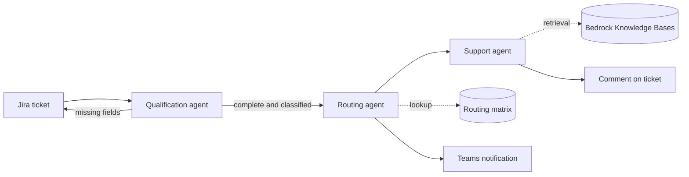

  

<h3 align="center">AI Engineer &nbsp;|&nbsp; LLM &amp; Agentic Systems &nbsp;|&nbsp; RAG</h3>

  

  
  
  

 

##  About

I build LLM systems that have to work in production, not just in a notebook. At **Closer** I design and develop agentic AI on AWS for enterprise clients, working across both implementation and architecture. My focus is on the parts that decide whether an AI system is actually useful: grounding, routing, evaluation and integration with the tools people already use.

MSc in Data Science.

 

##  Current Work

### Enterprise Ticket Triage with AI Agents
Closer &nbsp;|&nbsp; client project &nbsp;|&nbsp; Amazon Bedrock &nbsp;|&nbsp; AWS Serverless

A multi-agent system that takes incoming Jira service tickets for an industrial client and handles them end to end: it checks that the ticket is complete, sends it to the right team and drafts an answer grounded in the client's own documentation and ticket history. I work on development and on the architecture decisions.

<table>
<tr>
<td width="50%" valign="top">

**Agents**

 <b>Qualification</b> classifies the ticket and flags missing information 
 <b>Routing</b> assigns it to the right resolver group from a rules matrix 
 <b>Support</b> drafts a response using retrieval over documentation and past tickets 

**Knowledge ingestion**

 Multi-source pipelines from Jira (Cloud and On-Prem), SharePoint and product documentation into Bedrock Knowledge Bases 
 Two validation gates, PII redaction, deduplication and a quarantine and remediation loop for bad documents 

</td>
<td width="50%" valign="top">

**Routing that business users can maintain**

 The issue-type to resolver mapping lives in an Excel file on SharePoint that non-technical staff edit directly 
 Lambda + EventBridge poll it through the Microsoft Graph API, replacing an earlier Power Automate flow 

**Safety and delivery**

 Bedrock Guardrails in front of the agents, with input tagging to stop false prompt-attack detections on legitimate ticket text 
 Event-driven, serverless deployment with separate integration and agent repositories 
 Validated in UAT on a test Jira project, now moving to production starting with the knowledge bases and the Qualification agent 

</td>
</tr>
</table>

  
  
  
  
  
  
  

**Also exploring:** evaluation for agent and RAG reliability, multi-stage retrieval and inference, containerised AI services.

 

##  Selected Projects

<table>
<tr>
<td width="50%" valign="top">

### LusoChat
RAG academic assistant

Answers academic questions from a curated knowledge base instead of the model's memory, using a multi-stage inference pipeline and embedding-based semantic retrieval behind a FastAPI service.

`RAG` `Embeddings` `FastAPI` `Python`

</td>
<td width="50%" valign="top">

### Cyanotypes
AI matchmaking platform

Matches profiles by meaning rather than keywords, with NLP similarity and a vector ranking engine running as Dockerised inference services. Deployed in an EU research context.

`NLP` `Vector Ranking` `Docker` `Python`

</td>
</tr>
</table>

 

##  Stack

**AI / LLM**

  
  
  
  
  
  

**Backend, Cloud & Data**

  

 

##  International Presentations

Presented AI platforms and LLM systems at research and innovation events in

 Belgium &nbsp;&nbsp;
 Italy &nbsp;&nbsp;
 Czech Republic

 

##  Activity

  

Building production AI systems that go beyond demos.

